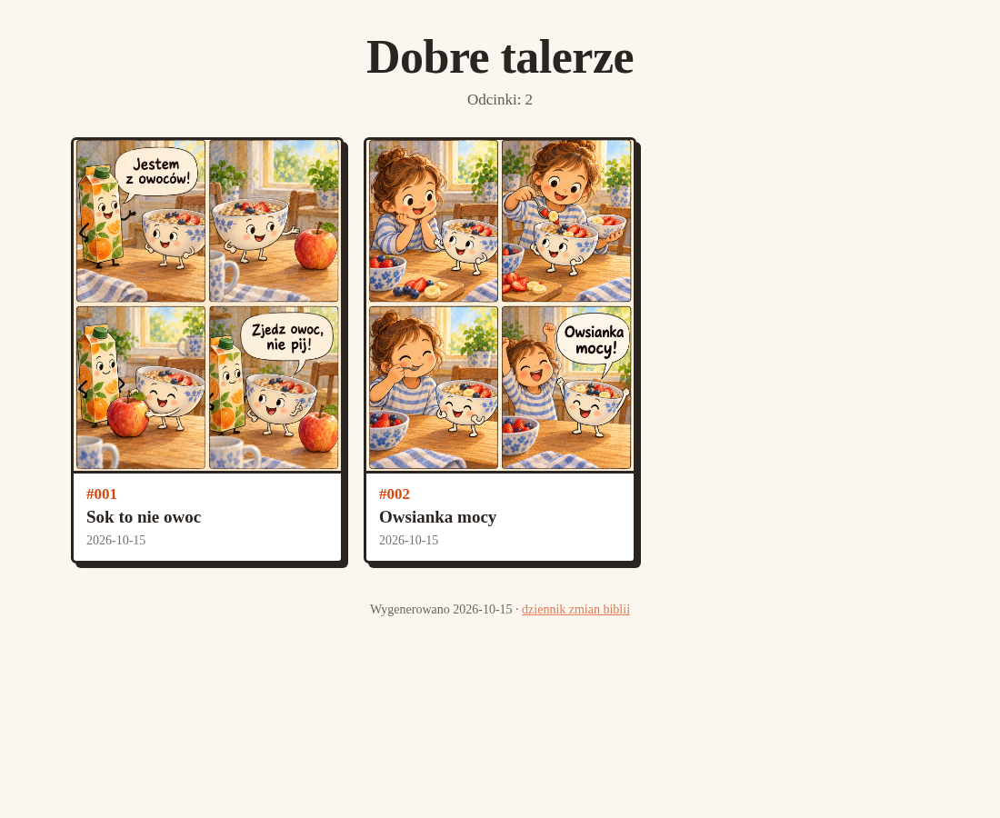

# Instalacja pluginu „komiks” — krok po kroku

Zajmie to ok. 15 minut. Wystarczy zrobić raz — kolejne wersje plugin zaproponuje sam.

## Czego potrzebujesz

- **Aplikację ChatGPT na komputer** (macOS albo Windows) — Codex jest jej częścią.
  W przeglądarce to nie zadziała: plugin pracuje na folderze na Twoim dysku.
- **Plan ChatGPT co najmniej Plus** (albo Go). Na planie Free Codex nie generuje obrazów.
  Każdy obraz zużywa limit kilka razy szybciej niż zwykła wiadomość.
- **Python 3** — mały program, którego plugin używa do porządkowania plików.
  Na Macu zwykle wystarczy jedno kliknięcie przy pierwszym użyciu (patrz „Problemy”).

## 1. Folder na komiksy

Utwórz zwykły folder, np. `Dokumenty/Komiksy`. Tu będą wszystkie Twoje komiksy:
biblia postaci, odcinki, wszystkie wersje obrazów, gotowe pliki i strona. Plugin
zapamięta go jako **bibliotekę** (zapyta o to w pierwszej rozmowie), więc kolejne
komiksy trafią tutaj, nawet jeśli później otworzysz w Codexie inny folder.

## 2. Otwórz ten folder w Codexie

W aplikacji ChatGPT przejdź do **Codex** i wybierz folder `Komiksy` jako projekt.

## 3. Dodaj nasz katalog pluginów i plugin

Napisz do Codexa (skopiuj całość):

> Uruchom w terminalu po kolei:
> `codex plugin marketplace add guc-net/codex-marketplace`
> `codex plugin add komiks@guc-net`
> i powiedz mi, czy się udało.

Codex poprosi o zgodę na uruchomienie poleceń i dostęp do internetu — zgódź się.
Powinien odpowiedzieć, że dodał katalog `guc-net` i plugin `komiks`.

Jeśli Codex powie, że **nie ma polecenia `codex`**, poproś go:

> Zainstaluj Codex CLI (`npm install -g @openai/codex`, a na Macu z Homebrew
> `brew install --cask codex`) i powtórz poprzedni krok.

Jeśli i to się nie uda — umów się z nami na 15 minut zdalnie, zrobimy to razem.

## 4. Uruchom aplikację ponownie

Zamknij aplikację ChatGPT całkowicie i otwórz ją jeszcze raz. W **Plugins** zobaczysz
źródło **guc-net** z pluginem **Komiks** (zainstalowany, włączony). Jeśli jest
na liście, ale niezainstalowany — kliknij plus przy nim.

## 5. Pierwsza rozmowa

Zacznij **nową** rozmowę w Codexie, w folderze `Komiksy`, i napisz:

> Zacznijmy nowy komiks

Plugin przygotuje folder, zapyta o tytuł i poprowadzi Cię przez projekt.
Co dalej — w ściądze [jak-zaczac.md](jak-zaczac.md).

## Aktualizacje

Nic nie musisz pamiętać. Na początku rozmowy (raz dziennie) plugin sprawdza, czy jest
nowsza wersja. Jeśli jest, powie, co się zmieniło, i zapyta „Zaktualizować teraz?”.
Po „tak” sam uruchomi aktualizację i poprosi o nową rozmowę.

Ręcznie (gdyby trzeba): poproś Codexa o `codex plugin marketplace upgrade guc-net`,
potem zacznij nową rozmowę.

Aktualizacja pluginu **nie zmienia Twoich komiksów** — biblia, odcinki i obrazy zostają.

## Problemy

| Objaw | Co zrobić |
|---|---|
| Mac pyta o „narzędzia wiersza poleceń” przy pierwszym użyciu | Kliknij **Zainstaluj** — to jest Python, którego plugin potrzebuje. Potem powtórz prośbę. |
| Windows: „python nie został znaleziony” | Poproś Codexa: „Zainstaluj Pythona przez `winget install Python.Python.3.12`”. Potem uruchom aplikację ponownie. |
| Pluginu nie ma w Plugins | Zamknij i otwórz aplikację ponownie; sprawdź w nowej rozmowie. |
| Plugin mówi, że nie mógł sprawdzić aktualizacji | Nic złego — sprawdzi następnym razem. |
| Obrazy przestały się generować | Wyczerpał się limit planu. Poczekaj na odnowienie albo dokup kredyty w ustawieniach. |

## Jak wygląda wynik

Strona komiksu, którą plugin składa sam (otwiera się dwuklikiem w `strona/index.html`):

