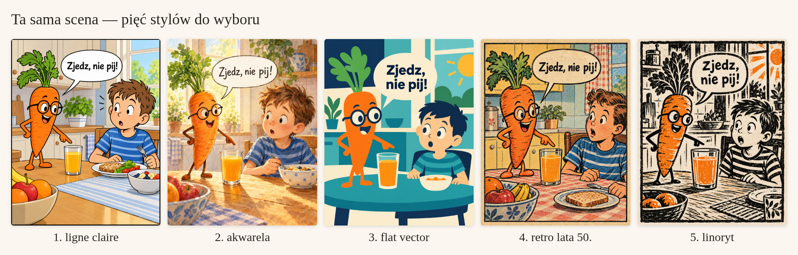
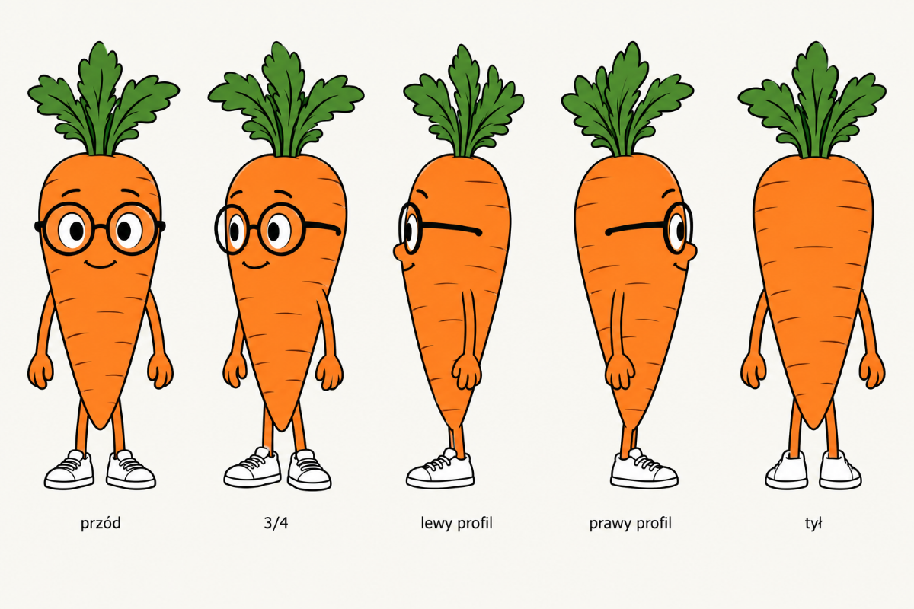

# Jak sprawić, żeby komiks był zawsze spójny graficznie

Model nie pamięta Twojej postaci między obrazami. Spójność bierze się z dwóch rzeczy:
**tych samych obrazów wzorcowych** podanych przy każdym rysowaniu i **tych samych
słów** w opisie. Plugin pilnuje obu — ale to Ty decydujesz, co w nich jest.

## Co warto zdefiniować (raz, w projekcie)

| Co | Przykład | Gdzie |
|---|---|---|
| styl | ligne claire, czarny kontur 2 px, płaskie kolory | `biblia/styl.md` + 2–3 obrazy wzorcowe |
| paleta z kodami | #F4A259 marchewkowy, #2B2522 kontur, #FBF7F0 tło | `styl.md`, `postac.md` |
| kreska i faktura | równy kontur, bez kreskowania, lekki papier | `styl.md` |
| światło | dzienne z lewej, miękkie cienie | `styl.md` |
| kadrowanie | kamera na wysokości oczu, plany średnie | `styl.md`, `kadry.md` |
| dymki | białe, okrągłe, czarny krój bez szeryfów, max 12 słów | `dymki.md` |
| postaci | proporcje (np. 4 głowy wzrostu), kolory, znaki szczególne, ubiór | `postaci/<imię>/postac.md` |
| postaci z każdej strony | przód, tył, lewy i prawy profil, 3/4; na życzenie z góry i z dołu | `postaci/<imię>/widoki/` |
| miny i pozy | 6 min, 3–6 typowych póz | `mimika.png`, `pozy/` |
| rekwizyty | zawsze ta sama torba, ten sam kubek | `postac.md` (znaki szczególne) |
| miejsca | kuchnia, gabinet — obraz tła | `miejsca/` |
| czego nie chcesz | fotorealizm, plastikowy połysk, „wygląd AI”, inne style | `styl.md` → Nie rób |

## Co zawsze mówić modelowi (plugin robi to za Ciebie)

1. **Stały blok stylu** — 2–4 zdania, zawsze tymi samymi słowami, na początku.
2. **Obrazy na wejściu** — wzór stylu, arkusz każdej postaci w kadrze, widok, który
   pasuje do ujęcia (np. z tyłu), tło miejsca — i które jest które.
3. **Blok postaci** — 1–3 stałe zdania o każdej postaci.
4. **Negatywy** — lista „nie rób”.
5. Dopiero potem: co się dzieje w kadrze i dokładny tekst dymków w cudzysłowie.

## Czego unikać

- Opisywania postaci za każdym razem innymi słowami („ruda dziewczynka”, „Ola
  z warkoczami”) — to zmienia jej wygląd.
- Mieszania stylów w trakcie („teraz bardziej jak Pixar”). Nowy styl = świadoma zmiana
  biblii.
- Bardzo długich próśb. Krótko i konkretnie działa lepiej.
- Kilku poprawek naraz — zmieniaj jedną rzecz w jednej wersji.
- Generowania od zera, gdy chcesz tylko poprawić drobiazg.

## Jak poprawiać

- **Edycja zamiast nowego obrazu:** „W kadrze 3 niech Ola się uśmiecha, resztę zostaw
  dokładnie tak samo” — plugin bierze poprzednią wersję na wejście.
- Możesz zaznaczyć fragment obrazu i opisać zmianę tylko tam.
- Jeśli postać „odjeżdża” w jednym ujęciu (np. zawsze źle z tyłu) — brakuje dobrego
  widoku w arkuszu. Plugin zaproponuje jego dorobienie.
- Stała zmiana wyglądu („od teraz okulary”) przechodzi przez zgodę **TAK** i zostaje
  zapisana w dzienniku zmian.

## Przykłady

Ta sama scena w pięciu stylach (tak wyglądają propozycje na start):

Arkusz obrotu postaci — przód, 3/4, lewy profil, prawy profil, tył:

